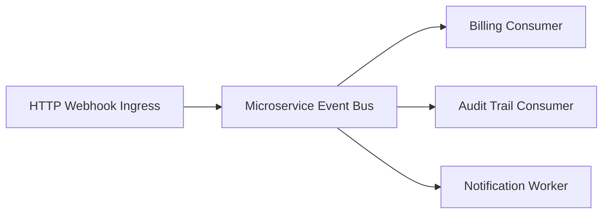

# Flask Microservices Event Bus & Webhook Router

[](https://github.com/FelipeMadson/flask-microservices-event-bus/actions)
[](LICENSE)
[](https://github.com/FelipeMadson/flask-microservices-event-bus/releases)

High-throughput, decoupled event bus and webhook dispatching router built in Python 3.12 and Flask 3.

## Architecture



## Key Characteristics

- **Decoupled Pub/Sub Engine**: High-speed topic subscriptions with typed Pydantic payloads.
- **Audit & Replay History**: In-memory historical event journal for delivery verification and debugging.
- **Zero Heavy Brokers**: Lightweight, self-contained architecture suitable for serverless and containerized microservices.

## Testing

```bash
pip install -e ".[test]"
pytest -v
```

## Author

Developed by **[Felipe Madison](https://github.com/FelipeMadson)**.
