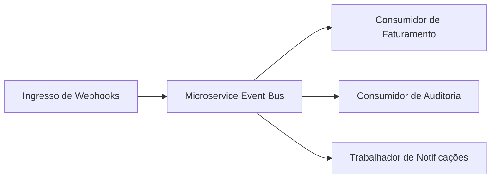

# Barramento de Eventos e Roteador de Webhooks com Flask 3

[](https://github.com/FelipeMadson/flask-microservices-event-bus/actions)
[](LICENSE)
[](https://github.com/FelipeMadson/flask-microservices-event-bus/releases)

Barramento de eventos desacoplado e roteador de webhooks de alta performance em Python 3.12 e Flask 3.

## Arquitetura de Microsserviços



## Destaques de Engenharia

- **Padrão Pub/Sub Tipado**: Inscrição por tópicos com validação estrita de esquemas via Pydantic v2.
- **Histórico Auditável**: Registro em memória de todos os eventos recebidos para inspeção e depuração.
- **Leve e Hermético**: Zero necessidade de brokers externos pesados para ambientes isolados.

## Execução e Testes

```bash
pip install -e ".[test]"
pytest -v
```

## Autor

Desenvolvido por **[Felipe Madison](https://github.com/FelipeMadson)**.
